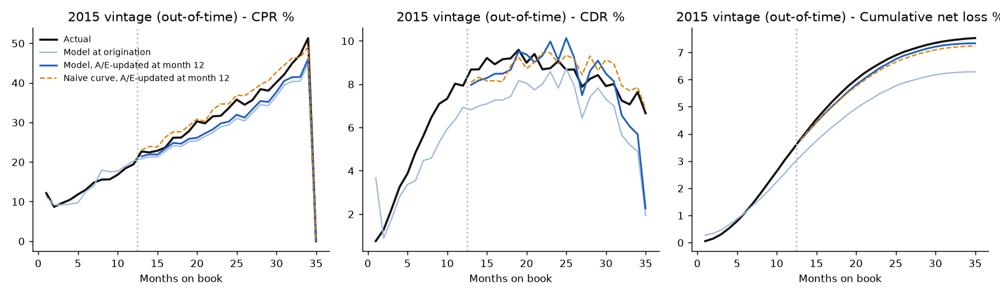
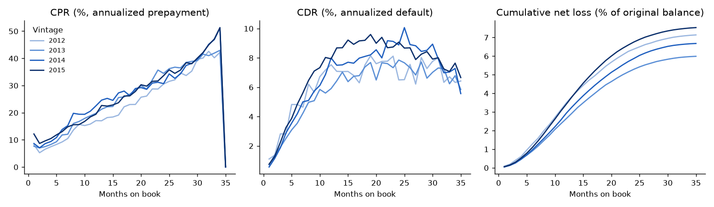
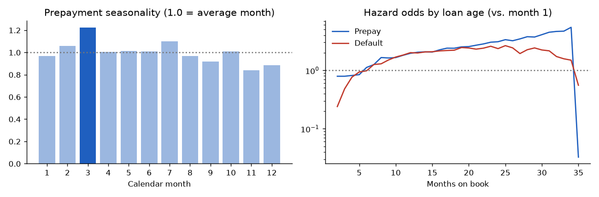

# Personal-Loan ABS Collateral Model: Prepayment, Default and Loss Projection

A collateral analysis for an asset-backed pool of **unsecured personal loans**, built on 589,249 public Lending Club loans with fully observed lives. It covers:
- static-pool CPR, CDR and cumulative-net-loss curves by vintage;
- a loan-level **competing-risks hazard model** for prepayment and default;
- **out-of-time pool projections**, both at origination and after 12 months of performance;
- **Basel IRB retail capital** and a default-stress sensitivity.

**The question:** how well can a pool's lifetime prepayments and losses be projected, at issuance and once the pool has seasoned? And what drives them?

## Headline results (2015 vintage: 282,787 loans, $3.62B, never used in fitting)

| Projection of the 2015 pool | Lifetime cumulative net loss | Error vs. actual | CPR error (avg, pts) | CDR error (avg, pts) |
|---|---|---|---|---|
| **Actual** | **7.53%** | | | |
| Hazard model, at origination | 6.29% | −1.24 pts | 2.53 | 1.38 |
| Naive curve (2012–14 average), at origination | 6.36% | −1.17 pts | 1.48 | 0.91 |
| **Hazard model, A/E-updated after 12 months** | **7.34%** | **−0.19 pts** | 2.49 | 0.81 |
| Naive curve, A/E-updated after 12 months | 7.24% | −0.29 pts | 1.53 | 0.59 |

* **2015 was a worse vintage, and nothing fitted on earlier vintages saw it at issuance.** Both methods under-project lifetime loss by about 1.2 points.
* **Twelve months of seasoning fixes most of the gap.**
  * Scaling the hazards by the pool's actual-to-expected (A/E) ratios cut the model's lifetime-loss error from **1.24 to 0.19 points**.
  * The 12-month ratios were 1.20× for defaults and 1.04× for prepayments.
  * This is how a surveillance analyst re-projects a seasoning ABS deal.
* **The hazard model doesn't beat the naive curve on pool totals.**
  * On the 2014 validation fold the updated naive curve was closer on lifetime loss (−0.59 vs. −0.74 points), though the model tracked CPR much better (1.8 vs. 4.0 points).
  * The model's value is loan-level: it handles changes in pool mix and refinancing incentives, and it ranks defaults slightly better than the lender's sub-grade (lifetime default AUC 0.688 vs. 0.679).
* **Prepayments peak in March (+22% vs. an average month), during tax-refund season.** They are lowest in November–December (−16% and −12%).
* **Capital:** the Basel IRB "other retail" formula with a 12-month PD of 3.8% and LGD of 89% gives **9.9% capital per dollar of exposure** (RWA density 124%), rising from 8.8% for A grade to 15.9% for G grade.
* **Stress:** doubling the default hazard lifts projected lifetime net loss from 6.3% to 11.7%; tripling it gives 16.4%.



---

## 1. Data and definitions

* **Source:** Lending Club accepted loans, 2007–2018 (2,260,668 loans, public CC0 copy). Kept: 36-month individual loans issued 2012–2015 with a final status. Every one of them was scheduled to mature before the March 2019 snapshot, so each loan's whole life is observed.
* **Events.** Each loan ends in one of three ways:
  * **prepay:** paid in full at least 2 months before the scheduled maturity;
  * **default:** charged off, timed at the first payment never made (the month after the last payment);
  * **matured:** ran to term.
* **Balances.**
  * Pool curves use each loan's *scheduled* amortizing balance, so pools are comparable.
  * Losses are realized net losses: principal outstanding minus net recoveries.
  * Loss severity (LGD) on training-vintage defaults is **89%**, as expected for unsecured debt.
* **Curves:**
  * SMM = prepaid balance ÷ performing balance; CPR = 1 − (1 − SMM)^12.
  * MDR and CDR are the same for defaults.
  * CNL = cumulative net loss ÷ original balance.
* **Month 35 shows CPR near zero by construction:** payoffs in the final scheduled months count as maturity, not prepayment.

| Vintage | Loans | Original balance | Prepaid early | Defaulted | Lifetime CNL | Avg CPR | Avg CDR |
|---|---|---|---|---|---|---|---|
| 2012 | 43,470 | $0.51B | 48.2% | 13.6% | 7.14% | 22.4% | 6.3% |
| 2013 | 100,422 | $1.27B | 53.5% | 12.3% | 5.99% | 25.1% | 5.9% |
| 2014 | 162,570 | $2.05B | 54.5% | 13.7% | 6.68% | 26.1% | 6.8% |
| 2015 | 282,787 | $3.62B | 53.5% | 14.9% | 7.53% | 25.8% | 7.2% |



## 2. Competing-risks hazard model

A discrete-time hazard model is fitted on loan-months. Each month a performing loan either stays current, prepays in full, or defaults; a **multinomial logit** estimates both competing hazards jointly.

| Covariate group | Variables |
|---|---|
| Borrower at origination | FICO, DTI, log income, log loan amount, interest rate, employment length, revolving utilization, recent inquiries, delinquencies, loan purpose, home ownership, income verification |
| Loan age | one indicator per month on book (2–35), so the seasoning curve is unconstrained |
| Calendar | month-of-year indicators (seasonality) |
| Refinancing incentive | the loan's rate minus Lending Club's going rate for the same sub-grade in that calendar month, plus its positive part. It is built from the lender's own issuance data. |

**Fitting.**
* The final model is fitted on a 40% random sample of loans (whole lives) from the 2012–2014 vintages: 2.99M loan-months, sampled to fit in laptop memory.
* Specification choice uses fold 1 only: train 2012–13, project 2014. The question was whether to include the refinancing incentive. Including it cut the updated 2014 CPR error from 3.5 to 1.8 points, so it stays.
* The 2015 vintage is projected once, with the chosen specification.

**Drivers.**
* Each extra point of refinancing incentive raises the monthly prepayment odds by about 5%.
* Twenty more FICO points cut the monthly default odds by about 11%, holding the interest rate fixed.
* Default hazards peak around 12–25 months on book. Prepayment hazards keep rising toward maturity.



## 3. Projection method

* **At origination:** every loan in the pool is run forward month by month with its own hazards. Surviving balance, prepayments, defaults and losses (default balance × LGD) are summed into pool curves.
* **After 12 months:**
  * Compute actual-to-expected (A/E) ratios: observed prepayment and default counts in months 1–12, divided by the model's expected counts.
  * Scale the remaining hazards by those ratios.
  * Project only the loans actually still outstanding at month 12. Realized losses to date are added.
* **Naive benchmark:** the 2012–2014 vintages' average SMM/MDR by month on book, applied to the pool's balance path. It gets the same A/E update.
* **Scored on:** average absolute CPR and CDR error over the projected months, lifetime CNL error, and weighted average life. Actual WAL is 1.29 years; the model at origination gives 1.31.

## 4. Capital and stress (2015 pool at origination)

| Grade | Loans | Exposure | 12-month PD | IRB capital (% of exposure) | RWA density |
|---|---|---|---|---|---|
| A | 70,100 | $1,014M | 1.9% | 8.8% | 110% |
| B | 91,645 | $1,147M | 3.1% | 9.8% | 123% |
| C | 77,348 | $920M | 4.7% | 10.4% | 130% |
| D | 32,668 | $402M | 7.0% | 11.0% | 138% |
| E | 9,424 | $121M | 9.0% | 11.7% | 146% |
| F–G | 1,602 | $17M | 15–22% | 13.8–15.9% | 172–199% |
| **Pool** | 282,787 | $3,621M | 3.8% | **9.9%** | **124%** |

* **Formula:** Basel IRB "other retail" risk weight, with asset correlation between 3% and 16% depending on PD, and the 99.9% Vasicek quantile (no maturity adjustment for retail).
* **PD and LGD:** the 12-month PD comes from the hazard model. LGD is the realized 89% from training vintages; it is not a downturn LGD, which would be higher.
* **The model's 12-month PD is low.** It averaged 3.8%, while 4.7% of the pool actually defaulted in its first 12 months. That is the same vintage drift as above, so the capital figure is understated by roughly that ratio.

**Default stress at origination** (lifetime CNL; actual was 7.53%):

| Default hazard × | 1.0 | 1.5 | 2.0 | 3.0 |
|---|---|---|---|---|
| Projected lifetime CNL | 6.29% | 9.09% | 11.69% | 16.38% |

Actual 2015 losses landed between the base case and the 1.5× stress, which is why ABS credit enhancement is sized as a multiple of the base-case loss.

## Limitations

* **Consumer installment loans, not mortgages.** Prepayment here comes from refinancing into cheaper personal loans or paying off with cash windfalls (note the March peak). There is no house-price or mortgage-rate channel.
* **No partial prepayments (curtailments).** The public file has one row per loan, not monthly tapes, so only full payoffs are observed. Default timing uses the month after the last payment.
* **No macro drivers.** Unemployment fell almost steadily from 2012 to 2018, so its effect can't be estimated from these vintages. A CCAR-style projection would need a macro-sensitive model fitted on a full cycle.
* **Fitting sample.** The final model uses 40% of training loans to fit in memory. Pool projections use every loan.

## Reproduce

Needs Python 3.11 and about 4 GB of free RAM.

```bash
pip install -r requirements.txt
# public CC0 copy of the Lending Club accepted-loans file (1.68 GB)
curl -L -o data/raw/accepted_2007_to_2018Q4.csv \
  https://huggingface.co/datasets/codesignal/lending-club-loan-accepted/resolve/main/accepted_2007_to_2018Q4.csv
python src/build_loans.py   # ~30 s: loan-level life table + sub-grade rate grid
python src/model.py         # ~3 min: curves, hazard model, projections, capital, stress
```

```
src/config.py        paths, vintages
src/build_loans.py   events, timing, balances, losses, going-rate grid
src/model.py         static-pool curves, competing-risks hazard model, A/E-updated projection,
                     naive benchmark, Basel IRB capital, stress
results/             all tables (CSV/JSON)
reports/figures/     charts used above
```
